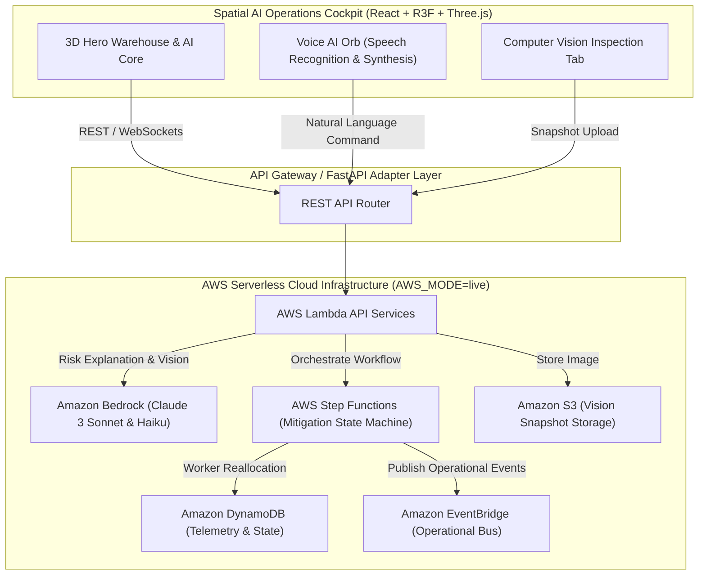

# FLOWGUARD AI — Spatial AI Operations Cockpit

> **Tagline:** “Predict. Explain. Act. Verify.”

FlowGuard AI is a futuristic autonomous fulfillment-operations intelligence platform. It monitors a simulated fulfillment facility in interactive 3D, detects emerging bottlenecks, forecasts operational SLA risks using Amazon Bedrock, explains root cause reasoning, recommends corrective actions, and executes autonomous worker redistribution workflows via AWS Step Functions.

***

> [!IMPORTANT]
> **Synthetic Data & Hackathon Prototype Disclaimer**  
> FlowGuard AI is an original hackathon prototype inspired by large-scale fulfillment operations. It is **NOT** an official Amazon product, does **NOT** use any proprietary Amazon data, and operates strictly on synthetic illustrative telemetry.

***

## 📐 Cloud Architecture Diagram



***

## 🌟 Core Features

1. **Spatial 3D AI Operations Cockpit**: Living 3D warehouse facility (React Three Fiber & Three.js) with 5 interactive physical zones (**PICKING, SORTING, PACKING, BUFFER, SHIPPING**), conveyor paths, moving packages, worker nodes, and 60 FPS performance.
2. **Dynamic 3D AI Core**: Central orbital holographic brain changing geometry and rotation speeds based on AI operational states (`IDLE`, `MONITORING`, `ANALYZING`, `RISK_DETECTED`, `PLANNING`, `EXECUTING`, `VERIFYING`, `RESOLVED`).
3. **Scroll & Mouse Parallax Interactions**: Mouse movements drive subtle depth parallax, camera lerping, and 3D environment orientation.
4. **Bedrock Root Cause Reasoning**: Spatial explanation panel (*"WHY IS THIS HAPPENING?"*) detailing order volume surges, bottleneck stations, SLA impact forecast window, confidence score (94%), and recommended actions.
5. **Closed-Loop Autonomous Mitigation**: 1-click trigger or automated state machine execution that visibly redistributes worker nodes in 3D from Buffer to Packing, lowering utilization from **91% → 72%** and resolving SLA risk (**71% → 9%**).
6. **What-If Scenario Simulator**: Sliders for **Order Load (100%–200%)**, **Workforce (50%–150%)**, and **Shipping Capacity (50%–150%)** with live animated comparison (*Without FlowGuard* vs *With FlowGuard*).
7. **Computer Vision Inspection**: Upload warehouse snapshots to detect packages, workers, blocked conveyor lanes, and congested stations with bounding box visual overlays.
8. **Voice AI Orb**: Floating 3D orb with animated audio waveform supporting English, Hindi, and Hinglish natural language command routing.
9. **1-Click Guided Demo Mode**: Automated 9-step sequence demonstrating the complete **PREDICT → EXPLAIN → ACT → VERIFY** lifecycle.
10. **Dual AWS Modes (`AWS_MODE=mock` & `AWS_MODE=live`)**: Seamless local execution out of the box without AWS credentials, or full live connectivity with Amazon Bedrock, Lambda, DynamoDB, S3, EventBridge, and Step Functions.

***

## 💻 Tech Stack

- **Frontend**: React 18, TypeScript, Vite, React Three Fiber, Three.js, `@react-three/drei`, Framer Motion, Recharts, Lucide React, TailwindCSS, Zustand.
- **Backend**: Python 3.11, FastAPI, Pydantic v2, boto3, Mangum (AWS Lambda compatibility), Uvicorn.
- **AWS Infrastructure**: AWS SAM (`template.yaml`), Amazon Bedrock, AWS Step Functions, Amazon DynamoDB, Amazon S3, Amazon EventBridge, AWS Lambda, API Gateway.

***

## ⚡ Quick Start & Local Setup

### 1. Frontend Setup
```bash
# Install NPM dependencies
npm install

# Start local Vite development server
npm run dev
```
The frontend will launch at `http://localhost:3000`.

### 2. Backend Setup
```bash
# Navigate to backend directory
cd backend

# Install Python dependencies
pip install -r requirements.txt

# Start FastAPI server with Uvicorn
uvicorn main:app --reload --port 8000
```
The API documentation is available at `http://localhost:8000/docs`.

***

## 🔐 Environment Variables (`.env.example`)

```env
AWS_MODE=mock
AWS_REGION=us-east-1
BEDROCK_MODEL_ID=anthropic.claude-3-sonnet-20240229-v1:0
BEDROCK_VISION_MODEL_ID=anthropic.claude-3-haiku-20240307-v1:0
DYNAMODB_TABLE=FlowGuardSimulationState
S3_BUCKET=flowguard-warehouse-vision-bucket
STEP_FUNCTIONS_ARN=arn:aws:states:us-east-1:123456789012:stateMachine:FlowGuardMitigation
```

***

## ☁️ AWS Cloud Deployment Guide

To deploy FlowGuard AI to AWS using AWS SAM:

```bash
cd infra
sam build
sam deploy --guided
```

This provisions API Gateway, Lambda, DynamoDB table `FlowGuardSimulationState`, S3 bucket `flowguard-warehouse-vision-bucket`, Step Functions state machine, and EventBridge event bus.

***

## 🛠️ AI Tools Used

Developed with assistance from Google DeepMind Antigravity AI agent.

***

## 👥 Team Contributions

- **3D Spatial Visualization & R3F Lead**: Spatial facility design, AI Core animations, camera controls.
- **AI Architecture & Bedrock Integration**: Bedrock prompts, risk explanation models, vision inspection pipeline.
- **Full-Stack & AWS Serverless Engineer**: FastAPI endpoints, Step Functions state machine, Zustand store.
